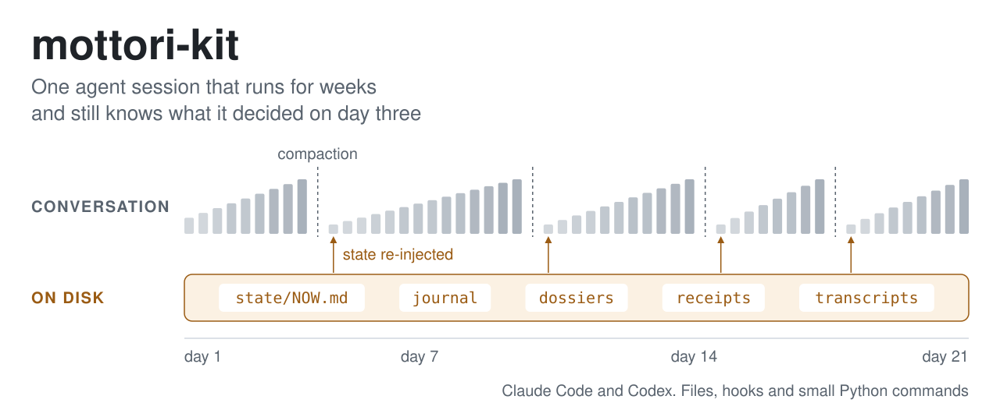

<p align="center">
  <picture>
    <source media="(prefers-color-scheme: dark)" srcset=".github/assets/hero-dark.svg">
    
  </picture>
</p>

# mottori-kit

**One conversation for all your work, with Claude Code, Codex or Antigravity.**

Chase a checkout bug, then draft chapter 4 of your novel, then compare two apartments, all in the same chat. Three
weeks and many compactions later, say "back to the checkout bug" and the agent starts from what you decided, why,
and what was next. No new chat per task, where each one starts from nothing and you explain it again.

What matters is written to plain files while you talk. Hooks put it back in front of the agent when a session
starts and after every compaction, and the agent opens a topic's own file when you come back to it. When the
agent says a piece of work is done, checks run before it reaches you. Your notes stay on your disk, with no
server, no database and no sync; only what the agent reads in a session goes to its model provider.

**Built to get out of the way of better models.** Most agent setups coach the model: long prompts on how to
think. A smarter model does not need them, and then they hold it back. This kit loads seven short rules, and nine
skills that open only when their moment comes. The rest is files and checks you would want however good the
model gets, because they save your attention, not the model's. Each part that only covers for a gap in today's
models is [listed with that gap](system/specs/model-assumptions.md): when a new model arrives, you test it again
and drop it if the gap has closed.

[Tutorial](TUTORIAL.md) · [Setup](SETUP.md) · [Manual](MANUAL.md) · [The seven rules](AGENTS.md) ·
[Design decisions](system/specs/kit-decisions.md) · [Changelog](CHANGELOG.md)

## Try it

Clone it as a folder of its own, next to your code repositories:

```bash
git clone https://github.com/Lee-Gihun/mottori-kit ~/work
cd ~/work
```

Open Claude Code, Codex or Antigravity there and say:

> Read SETUP.md and set up this folder. Show me what doctor, the kit's health check, says when you finish.

To work on a code repository from here, add it to the session: `claude --add-dir ~/code/shop`. Codex and
Antigravity take the same flag. Then talk as you always do. [The tutorial](TUTORIAL.md) walks through the first
hour: a decision, a second topic in the same chat, a file for a long topic, a compaction, and a turn the kit
stops.

## What is in it

### Remembering across compactions

**Decisions, one line each.** You say "a lock, not a queue: a queue adds a second at sale peaks." The agent
writes one line to the journal:

```text
[checkout/decision] Fix the cart race with a lock, not a queue: a queue adds a second of wait at sale peaks
```

Every session start and every compaction puts the newest lines back in front of the agent.
`python3 tools/now.py context` prints exactly what it is given.

**A file for each long topic.** The checkout bug runs for weeks, so it gets a dossier: where it stands, what was
decided and why, what was rejected and why, what is still open, and the next move. Say "back to the checkout bug"
and the agent opens it and answers "Lock chosen. Next: the failing test" before it touches the code.

**Your own words, found again.** "What did I say about Friday nights at the Mapo flat?"
`python3 tools/recall.py find` searches what you typed in past sessions, in all three runtimes, and not the
agent's summaries of it.

**One folder per project.** `projects/shop/`, `projects/novel/`, `projects/apartment/`. A folder of notes you
already have moves in whole, as it is. The shop's code repository stays where it is; the project's README names
it, so the agent knows where to look.

<p align="center">
  <picture>
    <source media="(prefers-color-scheme: dark)" srcset=".github/assets/session-dark.svg">
    
  </picture>
</p>

### Checks when work is handed over

**Links and state, at the end of every turn.** The agent says the chapter 4 notes are done, but they link to
`ch3-outline.md`, which you renamed yesterday. The turn stops once, with the reason:

```text
Issues absent before this turn appeared: linkcheck: projects/novel/ch4-notes.md -> ch3-outline.md.
```

The same check stops a turn that edited a folder you marked read-only.

**A document handed over unread** (the delivery check). When the agent writes a document and gives it to you
without opening it again, the turn stops once and it reads it as you would.

**What stays private.** The lease with your ID number on it goes under `_private/`. Git ignores that folder,
and the commit and push checks refuse it even when someone forces it in. The agent suggests what belongs there;
you decide.

### Thinking and writing

**Thinking lenses** are thirteen questions, each for a side of a problem that is easy to miss. Before you sign
the lease, the agent's answer ends with the one it used:

> Lens (inversion): what would make you regret this lease for certain, and what's the cheapest way to find out
> first? It changed my answer from "go ahead" to "visit tonight, then sign."

The question is shown so that you can think with it. [All thirteen](system/skills/lenses/SKILL.md), each with a
worked example.

**Deep pass** is for one decision that cannot be undone, reaches people outside, or is expensive. The agent reads
before it forms options, tries to break the answer it favours, and comes back with one recommendation, the
strongest objection, and what would reverse it. [The steps](system/skills/deep-pass/SKILL.md).

**Plain writing** is for anything a person outside will read, such as the email asking the landlord about the
noise. It starts from who reads the text and the one thing it has to do. The guide was built from 63 drafts that
were sent back. [The guide](system/skills/plain-writing/SKILL.md).

**Large jobs** is for "read every file of the payments module and list where stock is checked." Before a job
that runs many workers or outlives the session, it fixes what the job measures, where it resumes after an
interruption, and how you will know it worked. [The six questions](system/skills/large-jobs/SKILL.md).

### Help from outside the conversation

**Workers that report in a few lines.** "Read the 40 files of the payments module and find every place stock is
checked." A fresh worker does the reading. Back comes a receipt: the verdict, what is still unknown, and where
the full trace is. Your conversation stays small.

**A second vendor's model.** Lock or queue? Claude proposes, Codex attacks the assumptions, and you get one
recommendation or the one decision still open, not their messages. [How](system/debate/README.md).

**A loop that improves the kit.** Once a week it reads new arXiv papers and your own corrections, builds at most
two proposed changes in a copy of the kit, runs the tests in a sandbox, and has a model that did not build the
change review it. What passes is saved as a patch for you to apply. It writes nothing into your files. It sends
your session messages and the kit's files to your runtime's model, so it stays off until you turn it on. It runs
on macOS only. [How it works](system/loop/README.md).

## When a better model arrives

I expect models to keep getting better and my attention to stay what it is. So the kit is meant to save my
attention, and it does not tell the model how to think.

I tested that on the part I like best, the thinking lenses: do they improve the agent's answers? Three judge
models from three vendors compared 26 pairs of answers without knowing which was which, one written with the lens
skill and one without. Where a judge picked a side, it was the lens side 52%, 58% and 56% of the time, too close
to tell from chance on 26 pairs. So the lenses stay for the person, which is why the agent shows you its question.
Whether seeing the question helps a person decide has not been measured.

Rules were the first thing I tried, and they did not hold. In five months of my own sessions there were thirteen
kinds of mistake the agent already had a rule against, such as handing over a document it had not reopened, and
twelve of them kept happening. So what has to happen every time is done by a hook or a check instead.

The kit still prescribes a method to the model in 24 places, and [one page](system/specs/model-assumptions.md)
lists each with its reason. The same page says whom each part is for: you, or a gap in today's models and
runtimes, such as a session that forgets across a compaction. When a better model arrives, you test the parts
that fill a gap again and drop the ones whose gap is gone. The page has the steps.

## Before you install

- Sessions you start in this folder get the kit. It does not install into a code repository, and it is not a
  plugin.
- Requirements: Python 3.9 or later, Git and Bash. There are no packages to install: the kit uses only Python's
  standard library. It was tested on macOS and is expected to work on Linux.
- On a company machine, read [the checklist](system/CHECKLIST.md) section A before you clone: your IT policy on
  outside repositories, project hooks and outside models.
- A fresh installation adds about 2,500 tokens to each new session: the [seven rules](AGENTS.md) and the names
  and descriptions of nine skills. The check at the end of a turn usually takes under a second.
- Claude Code and Antigravity were run in live sessions on a fresh installation. Codex was tested by replaying
  captured hook inputs and has not been run live yet. [How each was tested](MANUAL.md#hooks).
- This is a preview. No one new to the kit has used it alone for a week yet, so whether it saves a newcomer's
  attention is not measured.
- Everything that is yours is ignored by Git, so back it up yourself. [Where things are](MANUAL.md#where-things-are).
- Of three optional parts, the delivery check starts on, search by meaning starts on only when an embedding
  server on this machine already answers, and the improvement loop stays off until you turn it on.
  [What each needs and sends](MANUAL.md#optional).
- Taking only the lenses: copy [`system/skills/lenses/`](system/skills/lenses/SKILL.md) into any project, or read
  the table yourself. There is nothing to install.

[MIT license](LICENSE) · [Contributing](.github/CONTRIBUTING.md)
