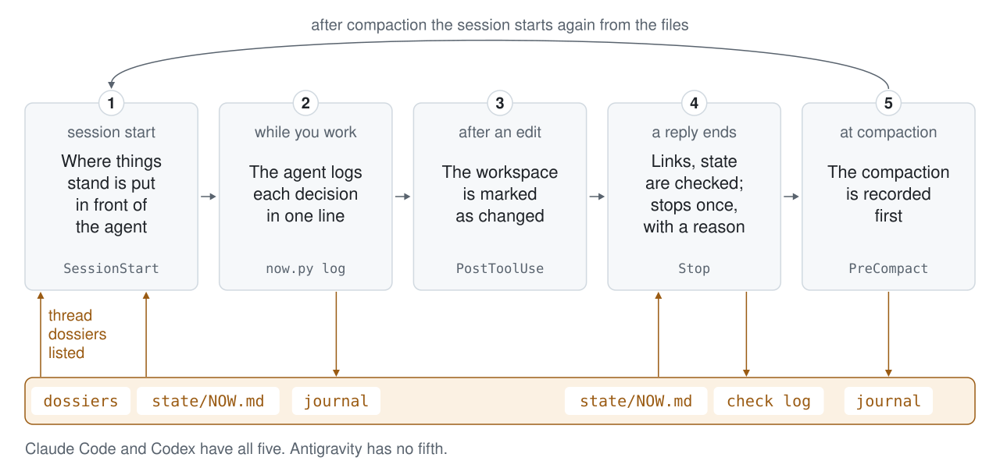
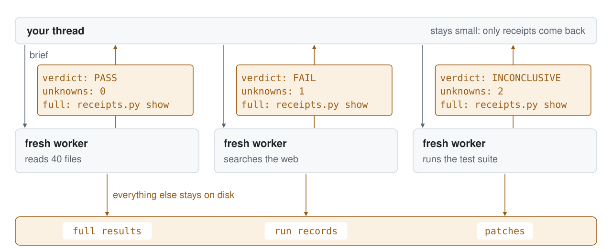

<p align="center">
  <picture>
    <source media="(prefers-color-scheme: dark)" srcset=".github/assets/hero-dark.svg">
    
  </picture>
</p>

**The conversation gets compacted. The state does not.**

mottori-kit is a workspace for long agent sessions with Claude Code and Codex. You clone it as a separate
folder for decisions, research, and documents, and you work inside it. It does not install into an existing
code repository. The session keeps what it decided, why, and what is still open, across compactions and
restarts. It is made of files, hooks, and small Python commands. There is no server, no database, and no
package to install.

[Setup](SETUP.md) · [Checklist after install](CHECKLIST.md) · [Design decisions](system/kit-decisions.md) ·
[Changelog](CHANGELOG.md) · <a href="ko/README.md">Korean</a>

## What breaks in a long session

| What breaks | What the kit does |
|---|---|
| After a few compactions the agent works from a summary of a summary. A week-old note passes for the current state. | State lives in files. Hooks rebuild the current state from those files at every session start and after every compaction, within a 6,000-byte limit. |
| You return to a thread from ten days ago. The agent rebuilds the easy half and skips the reasons you rejected the obvious option. | The rules have the agent keep one dossier per long thread, with five fields: position, decisions and reasons, rejected options and reasons, open questions, next move. The dossier list is part of the injected state, and the agent rereads the dossier before it continues. |
| "Done" arrives, and the document was never opened again after the last edit. | On Claude Code, a link and state check runs at the end of a turn in about 0.4 seconds, and a separate hook records when a document is handed over unread. |
| One broad search pours 200 KB of tool output into the conversation. | Broad work goes to fresh workers through `tools/fresh_worker.py`. Only a receipt of at most 4,096 bytes comes back: the worker's verdict, what stayed unknown, and where the full result is. |
| The rules file grows until nothing in it is followed. | Seven rules are always loaded, each with its reason. Everything else is read when its situation comes up. |
| You hit a usage limit and move from Claude Code to Codex in the middle of a task. The new session knows nothing, so you paste the last answer by hand. | Both runtimes start from the same files. A handoff note carries what lived only in the conversation (`/handoff` on Claude Code, the same procedure on request in Codex), and the next session's state view points to it. |
| Finished work, scratch copies, and transcripts pile up until the disk is full and nothing can be found. | Each job folder carries a one-page status, scratch lives in one place, and `doctor` warns about free disk space, an oversized `.git`, stale scratch, and job folders without a guide. Nothing is deleted for you. |
| Private notes end up in a commit. | Git ignores everything except the engine folders, so your documents, state, and notes stay out of commits by default. Check staged files before you commit anything under an engine folder. |

## How one session runs

<p align="center">
  <picture>
    <source media="(prefers-color-scheme: dark)" srcset=".github/assets/session-dark.svg">
    
  </picture>
</p>

1. **Session start.** `tools/now.py` builds one view from the journal and injects it: your tracks, the list
   of thread dossiers, and the newest decisions first. Public state and your private overlay are merged.
2. **While you work.** The agent records each decision, correction, and lesson in one line:
   `python3 tools/now.py log "[track/decision] one line"`. That line is the state. The conversation is not.
3. **After an edit.** A hook marks the workspace as changed. Nothing else happens.
4. **End of turn.** If something changed, `tools/gate.py` checks links and state freshness, and
   `tools/deliver.py` records whether a document written in this turn was reopened before it was handed over.
   A failed check stops the turn once and says why.
5. **Before compaction.** The compaction is written to the journal. When the session resumes, step 1 runs
   again, so the agent starts from the files and not from the summary.

## Try it

Requirements: Python 3.8 or later, git 2.5 or later, Bash 3.2 or later, macOS or Linux. `claude`, `codex`, and
`node` are optional.

```bash
git clone https://github.com/Lee-Gihun/mottori-kit ~/work
cd ~/work
bash setup.sh --name work --context personal   # use --context work on a company machine
bash tools/install_hooks.sh --repair            # pre-commit backstop (.git/hooks is not cloned)
bash tools/install_hooks.sh --check
python3 tools/doctor.py                         # done when FAIL is 0
```

This takes about a minute. `tools/test_fresh_install.sh` exercises setup, hook repair, link checks, and
`doctor` in a temporary clone, in English and in Korean, on every release. If the shell came from another
mottori workspace, run `unset MOTTORI_INSTANCE` first.

Now start Claude Code or Codex in the folder. Once your runtime trusts the hooks, every new session starts
with a view of the current state. After a day of work on a product launch it looks like this:

```text
[state injection · public 0d ago · local overlay available]
The view that merges the public projection and the local overlay is canonical.

## PUBLIC STATE
# NOW

*Input freshness: journal 0d ago*

## Track status
- **Launch**: (no update line) (file 0d ago), source `launch/plan.md`
- **Research**: (no update line) (file 0d ago), source `research/notes.md`
- **Personal**: canonical not set (config personal_pointer) (personal area: contents are not shown in NOW)

## Live threads (dossiers)
- Pricing page experiment: dossier `launch/pricing-dossier.md`
*(Return ritual: when coming back to a deep thread, read its dossier first. PRD §3.3)*

## Recent decisions and phases
- 2026-11-18T09:12 [system/state] instance set up: work (personal), initialized after cloning the kit
- 2026-11-18T09:12 [launch/decision] Beta opens Dec 2 with two pricing tiers. Three tiers doubled support questions in the October test.
- 2026-11-18T09:12 [launch/decision] Free tier rejected: support load without conversion. Revisit after 500 paying accounts.

## Recent events
- 2026-11-18T09:12 [research/lesson] Retention studies: annual discounts above 20% did not raise 12-month retention in three of four datasets.
```

Your private overlay follows in the same view. It lives under `_private/` and never enters Git.

Log a decision and it stays. Compact the conversation, close the terminal, come back next week: the next
session starts from the same lines.

```bash
python3 tools/now.py log "[launch/decision] Beta opens Dec 2 with two pricing tiers."
python3 tools/now.py context               # what the next session will be given
python3 tools/recall.py find "pricing"     # search what was said in past sessions
```

A new track is private until you list it under `public_tracks` in `system/memory-config.json`. Private lines
go to the overlay under `_private/` and are injected the same way.

Then declare your own boundaries in `system/instance-rules.md` (replace every `CHANGEME`) and go through
[CHECKLIST.md](CHECKLIST.md). `SETUP.md` has the full procedure and the update path.

## What it costs

| | Cost | How it is kept there |
|---|---|---|
| Fixed context at session start, fresh install | about 7 KB, roughly 1,750 tokens by estimate, counting local files and configured hooks. Most of it is the seven rules | `python3 tools/context_budget.py` measures your own workspace and `doctor` warns when it grows past a line you set |
| State injection | at most 6,000 bytes | the newest decisions and the dossier list come first. What does not fit is counted, with the command that shows the rest |
| Check at the end of a turn | about 0.4 s after a small edit and about 0.1 s when nothing changed, measured on a fresh install | the turn-end check covers links and state only. The full release checks run at commit time in the kit's own tree |
| What a worker returns into your thread | at most 4,096 bytes | the full result stays on disk: `python3 tools/receipts.py show <run>` |
| Default output of a transcript search | at most 4,000 bytes of compact excerpts | `--full` restores the detailed format and `--max` asks for more matches |
| Install | about a minute | exercised in a temporary clone by `tools/test_fresh_install.sh` |

## Why checks, and not more rules

This kit was taken out of one workspace where one person has worked with agents every day since May 2026.
Before this version we read all 6,697 messages that person typed in five months and counted every time they
had to correct the agent: 2,243 corrections.

Thirteen kinds of recurring mistake already had a written rule against them. After the rule was written,
twelve of the thirteen kept recurring. For eight of them the rate per 1,000 messages stayed flat or went up.
In that workspace the commands the rules asked for were being run, and the mistakes still came back. This is
one person's record, and the kind of work changed over those months. It shows what happened there. It does
not show what a rule can do in general.

So the kit prefers an instruction placed next to the task, or a narrowly tested check, over a longer
always-on rules file.

- **Seven rules stay loaded.** A new rule goes into a document that is read in its situation. To add an eighth
  always-on rule, one of the seven has to leave.
- **An instruction sits next to the work it governs.** In a small controlled test on 12 invented tasks, none
  of 72 reports written with a short rule in the task prompt contained an unrequested addition. Without the
  rule, 19 of 72 did.
- **A check is narrow, and it keeps its own record.** The delivery check started with four signals. We ran
  them over 8,817 past turns before trusting them. One was right in 35 of 40 sampled cases and stayed. Two
  were right in 2 of 40 and 0 of 37 and were removed. Three later candidates were right in 12, 14, and 0 of 40 and
  were not added. By default no delivery signal stops a turn. Turning one on is your decision, and the replay
  numbers are there to inform it.

The same record shaped the rest. A turn-end check that took 84 seconds on a fresh install now takes about
0.4. In the original workspace, most of what the old check stopped was not caused by the turn it stopped.

## One thread, many workers

<p align="center">
  <picture>
    <source media="(prefers-color-scheme: dark)" srcset=".github/assets/workers-dark.svg">
    
  </picture>
</p>

Human attention is the most expensive resource here, and tokens are the cheapest. You talk to one thread.
Reading forty files, searching the web, or running a test suite happens in a fresh worker with its own
context. What comes back is a receipt. The worker's verdict comes first, then what it could not determine,
then the command that shows the full result.

```bash
python3 tools/fresh_worker.py --runtime codex --expect out/report.md brief.md
```

`--expect` makes the run fail when no non-empty file exists at that path after the worker ends.

## Take one piece

You do not have to adopt the workspace to use parts of it.

- [`system/lenses/`](system/lenses/README.md): thirteen thinking lenses, each with the question it asks, when
  to switch it on, and what it must leave behind. The folder works on its own.
- [`system/WORKING-WITH-AI.md`](system/WORKING-WITH-AI.md): how to order a large job from an agent so that it
  can stop, resume, and be checked.
- `tools/recall.py`: text search over your Claude Code and Codex transcripts, with the scope it searched
  stated when it finds nothing.
- `tools/fresh_worker.py` and `tools/receipts.py`: bounded workers and their receipts.
- `tools/context_budget.py`: what every session of yours starts with, in bytes and approximate tokens.

## What it does not do

- It is not a plugin for an existing code repository. It is the folder you work in.
- It has no embeddings and no semantic search. Recall is text search over the original transcripts.
- The turn-end checks run on Claude Code. Codex gets state injection and the compaction record.
- It does not back up your data. `state/` and `_private/` are outside Git on purpose. Arrange a backup.
- It does not include the original workspace's decision history, debate rounds, or person ledgers, or its
  recording watchers. On a company machine, check policy before you run the transcription tools.
- Windows is not supported.

## Layout

```text
AGENTS.md        The seven always-on rules. CLAUDE.md imports it.
tools/           The engine: now (state), recall (transcripts), rec (fact ledger), gate and deliver (checks),
                 fresh_worker and receipts (workers), doctor (install verifier), context_budget
system/          Rituals, lenses, deep-pass, WORKING-WITH-AI, the two specifications, design decisions
templates/       Files each workspace fills in
.claude/         Claude Code hooks and slash commands
.codex/          Codex hooks
ko/              Korean editions, same paths. ko/INDEX.md maps each pair
state/           Your state. Ignored by Git
_private/        Your private overlay. Ignored by Git
```

## Four design principles

**State lives on disk.** Everything that must persist is a file. Tools recompute the rest from those files.

**Generated views and ledgers are separate.** Do not edit `NOW.md` by hand. Change the journal, then
regenerate the view. The picture cannot drift from the record.

**Every rule has a reason.** The reason is a measured incident where possible. A rule without a reason is a
candidate for deletion.

**Judge from receipts, and verify passage and cause separately.** A gate says whether work passed. An
independent review says why it failed.

## Evidence

Numbers on this page are measurements, not guarantees. Install sequence and timing: `tools/test_fresh_install.sh`.
Turn-end check scope and timing, state injection, receipts, the delivery check, and the correction counts:
decision records KIT-DR-020 to KIT-DR-027 in [`system/kit-decisions.md`](system/kit-decisions.md). Default-deny
tracking: `.gitignore`, KIT-DR-002. The philosophy sentence above is an owner decision (KIT-DR-012).
