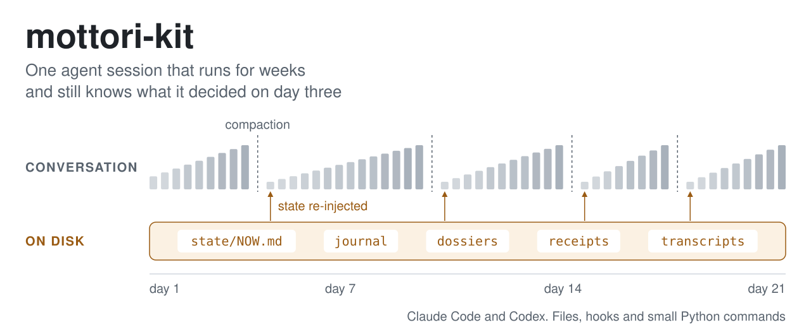
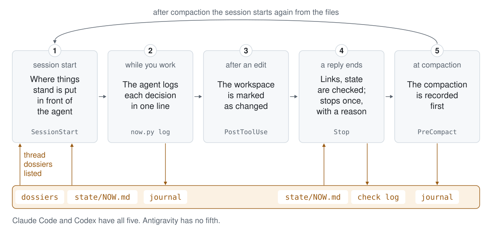
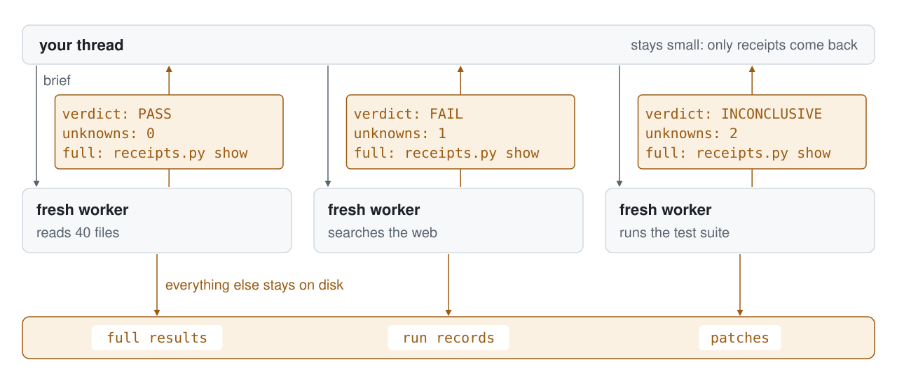

<!-- source: README.md sha256:c54bba63cad7a9790ee306def6296c0e0701facce7f0d7c49895a1cf1532af10 source-of-truth: en -->
<p align="center">
  <picture>
    <source media="(prefers-color-scheme: dark)" srcset="../.github/assets/hero-dark.svg">
    
  </picture>
</p>

**대화는 압축된다. 상태는 압축되지 않는다.**

mottori-kit은 Claude Code와 Codex로 긴 세션을 돌리기 위한 작업 폴더다. 결정, 조사, 문서를 두는 별도
폴더로 clone해서 그 안에서 일한다. 이미 있는 코드 저장소 안에 설치하는 것이 아니다. 세션은 무엇을
정했는지, 왜 정했는지, 무엇이 아직 열려 있는지를 압축과 재시작을 넘어 지닌다. 파일과 훅과 작은 Python
명령으로 되어 있다. 서버도, 데이터베이스도, 설치할 패키지도 없다.

[설치](SETUP.md) · [설치 뒤 점검](CHECKLIST.md) · [설계 결정](system/kit-decisions.md) ·
[변경 내역](CHANGELOG.md) · <a href="../README.md">English</a>

## 긴 세션에서 무너지는 것

| 무너지는 것 | 킷이 하는 일 |
|---|---|
| 압축이 몇 번 지나면 에이전트는 요약의 요약으로 일한다. 일주일 된 메모가 지금 상태 행세를 한다. | 상태를 파일에 둔다. 세션을 시작할 때마다, 압축이 끝날 때마다 훅이 그 파일에서 지금 상태를 다시 만들어 6,000바이트 안으로 넣어 준다. |
| 열흘 전 스레드로 돌아온다. 에이전트는 쉬운 절반만 다시 세우고, 뻔한 안을 왜 버렸는지는 건너뛴다. | 규칙이 에이전트에게 긴 스레드마다 서류철 하나를 지키게 한다. 칸은 다섯이다. 지금 위치, 결정과 이유, 버린 안과 이유, 열린 질문, 다음 수. 서류철 목록은 주입되는 상태에 들어 있고, 에이전트는 이어 가기 전에 서류철부터 다시 읽는다. |
| "다 됐다"가 온다. 그런데 그 문서는 마지막으로 고친 뒤 한 번도 다시 열리지 않았다. | Claude Code에서는 턴이 끝날 때 링크와 상태 검사가 0.4초쯤 돌고, 따로 있는 훅이 안 읽어 본 문서를 내놓으면 기록한다. |
| 넓게 찾는 일 하나가 도구 출력 200KB를 대화에 쏟는다. | 넓은 일은 `tools/fresh_worker.py`로 새 일꾼에게 맡긴다. 돌아오는 것은 4,096바이트 안의 영수증뿐이다. 일꾼의 판정, 확인하지 못한 것, 전문이 있는 곳. |
| 규칙 파일이 자라다가 아무것도 지켜지지 않는다. | 늘 실리는 규칙은 일곱 개이고 저마다 이유가 붙어 있다. 나머지는 그 상황이 왔을 때 읽는다. |
| 사용 한도에 걸려 일하던 도중에 Claude Code에서 Codex로 옮긴다. 새 세션은 아무것도 모르고, 앞 세션의 답을 손으로 붙여 넣게 된다. | 두 런타임이 같은 파일에서 시작한다. 대화 안에만 있던 것은 넘김 메모가 나른다(Claude Code에서는 `/handoff`, Codex에서는 같은 절차를 말로 청한다). 다음 세션이 받는 상태가 그 메모를 가리킨다. |
| 끝난 일, 임시 사본, 대화 기록이 쌓이다가 디스크가 차고 아무것도 찾을 수 없게 된다. | 일 폴더마다 상태 한 장을 두고, 임시 사본은 한 자리에만 만들고, `doctor`가 남은 디스크와 커진 `.git`과 오래된 임시 사본과 길잡이 없는 일 폴더를 경고한다. 대신 지워 주지는 않는다. |
| 비공개 메모가 커밋에 들어간다. | Git은 엔진 폴더 말고는 전부 무시한다. 그래서 문서와 상태와 메모는 기본으로 커밋에 들어가지 않는다. 엔진 폴더 아래의 파일을 커밋할 때는 스테이징된 파일을 확인한다. |

## 세션 하나가 도는 모습

<p align="center">
  <picture>
    <source media="(prefers-color-scheme: dark)" srcset="../.github/assets/session-dark.svg">
    
  </picture>
</p>

1. **세션 시작.** `tools/now.py`가 저널에서 한 장의 상태를 만들어 넣는다. 트랙, 스레드 서류철 목록, 가장 새
   결정이 먼저다. 공개 상태와 비공개 덧장이 합쳐진다.
2. **일하는 동안.** 에이전트가 결정, 바로잡은 것, 배운 것을 한 줄씩 적는다.
   `python3 tools/now.py log "[track/decision] 한 줄"`. 이 줄이 상태다. 대화는 상태가 아니다.
3. **편집 뒤.** 훅이 작업 폴더가 바뀌었다고 표시한다. 그 밖의 일은 하지 않는다.
4. **턴의 끝.** 바뀐 것이 있으면 `tools/gate.py`가 링크와 상태를 검사하고, `tools/deliver.py`가 이번 턴에 쓴
   문서를 다시 열어 본 뒤에 내놓았는지 기록한다. 검사가 실패하면 턴을 한 번 멈추고 이유를 말한다.
5. **압축 직전.** 압축을 저널에 적는다. 세션이 이어지면 1번이 다시 돈다. 그래서 에이전트는 요약이 아니라
   파일에서 시작한다.

## 해 보기

필요한 것: Python 3.8 이상, git 2.5 이상, Bash 3.2 이상, macOS 또는 Linux. `claude`, `codex`, `node`는 없어도 된다.

```bash
git clone https://github.com/Lee-Gihun/mottori-kit ~/work
cd ~/work
MOTTORI_LANG=ko bash setup.sh --name work --context personal   # 회사 컴퓨터에서는 --context work
bash tools/install_hooks.sh --repair            # 커밋 전 검사. .git/hooks는 clone되지 않는다
bash tools/install_hooks.sh --check
python3 tools/doctor.py                         # FAIL이 0이면 끝
```

1분쯤 걸린다. `tools/test_fresh_install.sh`가 출시 때마다 임시 사본에서 설치, 훅 수리, 링크 검사,
`doctor`를 영어와 한국어로 돌려 본다. 다른 mottori 작업 폴더에서 쓰던 셸이면 먼저 `unset MOTTORI_INSTANCE`를 한다.

이제 그 폴더에서 Claude Code나 Codex를 연다. 런타임이 훅을 믿는다고 승인한 뒤부터는 새 세션마다 지금
상태를 받고 시작한다. 제품 출시 일을 하루 한 뒤라면 이렇게 보인다.

```text
[상태 자동 주입 · public 0일 전 · local overlay available]
public projection과 local overlay를 합친 view가 정본이다.

## PUBLIC STATE
# NOW

*입력 신선도: journal 0일 전*

## 트랙 온도판
- **출시** — (갱신줄 없음) (파일 0일 전) → `launch/plan.md`
- **조사** — (갱신줄 없음) (파일 0일 전) → `research/notes.md`
- **개인** — 정본 미지정 (config personal_pointer) (개인 영역: NOW에 내용 비표시)

## 살아 있는 스레드 (서류철)
- 요금제 화면 실험 — 서류철 `launch/pricing-dossier.md`
*(복귀 의식: 깊은 스레드로 돌아올 때 서류철부터 읽는다 — PRD §3.3)*

## 최근 결정·국면
- 2026-11-18T09:12 [system/state] 인스턴스 세팅: work (personal) — 킷 클론 후 초기화
- 2026-11-18T09:12 [launch/decision] 베타는 12월 2일, 요금제 둘로 연다. 10월 시험에서 셋일 때 문의가 두 배였다.
- 2026-11-18T09:12 [launch/decision] 무료 요금제 기각: 전환 없이 문의만 는다. 유료 계정 500개 뒤에 다시 본다.

## 최근 사건
- 2026-11-18T09:12 [research/lesson] 유지율 연구: 연간 할인이 20%를 넘어도 네 자료 중 셋에서 12개월 유지율이 오르지 않았다.
```

같은 화면 아래쪽에 비공개 덧장이 이어진다. 덧장은 `_private/` 아래에 있고 Git에 들어가지 않는다.

결정을 적으면 남는다. 대화를 압축하고, 터미널을 닫고, 다음 주에 돌아와도 다음 세션은 같은 줄에서 시작한다.

```bash
python3 tools/now.py log "[launch/decision] 베타는 12월 2일, 요금제 둘로 연다."
python3 tools/now.py context             # 다음 세션이 받을 것
python3 tools/recall.py find "요금제"    # 지난 세션에서 오간 말을 찾기
```

새 트랙은 `system/memory-config.json`의 `public_tracks`에 적기 전까지 비공개다. 비공개 줄은 `_private/` 아래
덧장에 쌓이고 같은 방식으로 주입된다.

그다음 `system/instance-rules.md`에 자기 경계를 적고(`CHANGEME`를 전부 바꾼다) [CHECKLIST.md](CHECKLIST.md)를
따라간다. 전체 절차와 갱신 방법은 `SETUP.md`에 있다.

## 드는 값

| | 값 | 그 값을 지키는 방법 |
|---|---|---|
| 세션 시작에 고정으로 드는 컨텍스트, 새 설치 | 7KB쯤, 어림으로 1,750토큰. 로컬 파일과 설정된 훅만 센 값이다. 대부분이 규칙 일곱 개다 | `python3 tools/context_budget.py`가 내 작업 폴더를 재 주고, 정해 둔 선을 넘으면 `doctor`가 경고한다 |
| 상태 주입 | 6,000바이트 이하 | 가장 새 결정과 서류철 목록을 먼저 싣는다. 못 실은 것은 수를 알리고 나머지를 보는 명령을 적는다 |
| 턴 끝 점검 | 작은 편집 뒤 0.4초쯤, 바뀐 것이 없으면 0.1초쯤. 새 설치에서 잰 값이다 | 턴 끝에서는 링크와 상태만 본다. 출시용 전체 검사는 킷 자신의 트리에서 커밋할 때 돈다 |
| 일꾼이 내 스레드로 돌려주는 것 | 4,096바이트 이하 | 전문은 디스크에 남는다. `python3 tools/receipts.py show <run>` |
| 대화 원문 검색의 기본 출력 | 짧은 발췌로 4,000바이트 이하 | `--full`은 자세한 꼴로 돌아가고 `--max`는 더 많은 건수를 청한다 |
| 설치 | 1분쯤 | `tools/test_fresh_install.sh`가 임시 사본에서 돌려 본다 |

## 왜 규칙을 더 쓰지 않고 점검을 두나

이 킷은 한 사람이 2026년 5월부터 매일 에이전트와 일해 온 작업 폴더에서 떼어 냈다. 이번 판을 만들기 전에
그 사람이 다섯 달 동안 친 말 6,697개를 전부 읽고, 에이전트를 바로잡아야 했던 때를 셌다. 2,243번이었다.

되풀이되는 잘못 가운데 열세 가지에는 이미 글로 쓴 규칙이 있었다. 규칙을 쓴 뒤에도 열세 가지 중 열두 가지가
계속 되풀이됐다. 여덟 가지는 말 1,000개당 횟수가 그대로거나 늘었다. 그 작업 폴더에서는 규칙이 시킨
명령이 실제로 불리고 있었는데도 잘못이 다시 나왔다. 이것은 한 사람의 기록이고 그 다섯 달 사이 일의
종류도 바뀌었다. 거기서 무슨 일이 있었는지를 보여 줄 뿐, 규칙이 일반적으로 무엇을 할 수 있는지를
보여 주지는 않는다.

그래서 이 킷은 늘 실리는 규칙 파일을 늘리기보다, 그 일 옆에 둔 지시와 좁게 시험한 점검을 고른다.

- **늘 실리는 규칙은 일곱 개다.** 새 규칙은 그 상황에서 읽히는 문서에 둔다. 여덟째를 늘 실으려면 일곱 중
  하나가 내려가야 한다.
- **지시는 그것이 다스리는 일 옆에 둔다.** 지어낸 과제 열두 개로 한 작은 대조 시험에서, 과제 지시문 안에
  짧은 규칙을 두고 쓴 보고 72건에는 시키지 않은 덧붙임이 하나도 없었다. 그 규칙이 없을 때는 72건 가운데
  19건에 있었다.
- **점검은 좁게 겨누고 자기 기록을 남긴다.** 내놓기 전 점검은 신호 넷으로 시작했다. 믿기 전에 지난 8,817턴에
  먼저 대 봤다. 하나는 뽑아 본 40건 가운데 35건이 맞아서 남겼다. 둘은 40건 가운데 2건, 37건 가운데 0건이
  맞아서 지웠다. 그 뒤에 대 본 후보 셋은 40건 가운데 12건, 14건, 0건이 맞아서 넣지 않았다. 기본값에서는
  어떤 신호도 턴을 멈추지 않는다. 켜는 것은 쓰는 사람이 정하고, 대 본 숫자는 그 결정을 돕기 위해 있다.

나머지도 같은 기록에서 나왔다. 새 설치에서 84초 걸리던 턴 끝 점검이 이제 0.4초쯤이다. 원래 작업
폴더에서 옛 점검이 멈춘 것의 대부분은 그 턴이 만든 문제가 아니었다.

## 스레드 하나, 일꾼 여럿

<p align="center">
  <picture>
    <source media="(prefers-color-scheme: dark)" srcset="../.github/assets/workers-dark.svg">
    
  </picture>
</p>

여기서 가장 비싼 자원은 사람의 주의이고 가장 싼 자원은 토큰이다. 사람은 스레드 하나만 상대한다. 파일 마흔
개를 읽거나, 웹을 찾거나, 테스트 묶음을 돌리는 일은 자기 컨텍스트를 가진 새 일꾼이 한다.
돌아오는 것은 영수증이다. 일꾼의 판정이 맨 앞이고, 다음이 일꾼이 확인하지 못한 것, 다음이 전문을 보여
주는 명령이다.

```bash
python3 tools/fresh_worker.py --runtime codex --expect out/report.md brief.md
```

`--expect`를 주면, 일꾼이 끝난 뒤 그 경로에 비어 있지 않은 파일이 없을 때 실행이 실패한다.

## 한 조각만 가져가기

작업 폴더를 통째로 쓰지 않아도 조각을 가져다 쓸 수 있다.

- [`system/lenses/`](system/lenses/README.md): 사고렌즈 열세 개. 렌즈마다 묻는 질문, 켜는 때, 쓰고 나서 남길
  것이 있다. 이 폴더만으로 쓸 수 있다.
- [`system/WORKING-WITH-AI.md`](system/WORKING-WITH-AI.md): 큰 일을 에이전트에게 맡길 때, 멈추고 다시 잇고
  확인할 수 있게 주문하는 법.
- `tools/recall.py`: Claude Code와 Codex 대화 원문을 글자로 찾는다. 못 찾았을 때는 어디까지 찾았는지 말한다.
- `tools/fresh_worker.py`와 `tools/receipts.py`: 범위가 정해진 일꾼과 영수증.
- `tools/context_budget.py`: 내 세션이 매번 무엇을 안고 시작하는지, 바이트와 어림 토큰으로.

## 하지 않는 것

- 이미 있는 코드 저장소에 붙이는 플러그인이 아니다. 그 안에서 일하는 폴더다.
- 임베딩도 의미 검색도 없다. 회상은 대화 원문을 글자로 찾는 것이다.
- 턴 끝 점검은 Claude Code에서 돈다. Codex는 상태 주입과 압축 기록을 받는다.
- 내 자료를 백업해 주지 않는다. `state/`와 `_private/`는 일부러 Git 밖에 있다. 백업은 따로 마련한다.
- 원래 작업 폴더의 결정 이력, 토론 기록, 인물 원장, 녹음 감시 도구는 들어 있지 않다. 회사 컴퓨터에서는
  전사 도구를 돌리기 전에 회사 정책부터 확인한다.
- Windows는 지원하지 않는다.

## 구조

```text
AGENTS.md        늘 실리는 규칙 일곱 개. CLAUDE.md가 가져온다.
tools/           엔진: now(상태), recall(대화 원문), rec(사실 원장), gate와 deliver(점검),
                 fresh_worker와 receipts(일꾼), doctor(설치 검증), context_budget
system/          의식, 렌즈, 딥패스, WORKING-WITH-AI, 명세 둘, 설계 결정
templates/       작업 폴더마다 채우는 파일
.claude/         Claude Code 훅과 슬래시 명령
.codex/          Codex 훅
ko/              한국어판. 같은 경로. ko/INDEX.md가 짝을 싣는다
state/           내 상태. Git이 무시한다
_private/        내 비공개 덧장. Git이 무시한다
```

## 설계 원칙 넷

**상태는 디스크에 산다.** 남아야 하는 것은 전부 파일이다. 나머지는 도구가 그 파일에서 다시 계산한다.

**만들어지는 화면과 원장은 따로다.** `NOW.md`를 손으로 고치지 않는다. 저널을 고치고 화면을 다시 만든다.
그래서 화면이 기록과 어긋날 수 없다.

**규칙마다 이유가 있다.** 이유는 될 수 있으면 실제로 잰 사건이다. 이유가 없는 규칙은 지울 후보다.

**영수증으로 판단하고, 통과와 원인은 따로 확인한다.** 게이트는 통과했는지만 말한다. 왜 실패했는지는
독립된 검토가 말한다.

## 근거

이 문서의 숫자는 측정값이고 보증이 아니다. 설치 순서와 걸린 시간: `tools/test_fresh_install.sh`. 턴 끝 점검의
범위와 시간, 상태 주입, 영수증, 내놓기 전 점검, 바로잡은 말의 집계: [`system/kit-decisions.md`](system/kit-decisions.md)의
결정 기록 KIT-DR-020부터 KIT-DR-027. 기본 무시 방식: `.gitignore`, KIT-DR-002. 위 "가장 비싼 자원" 문장은
소유자의 결정이다(KIT-DR-012).
