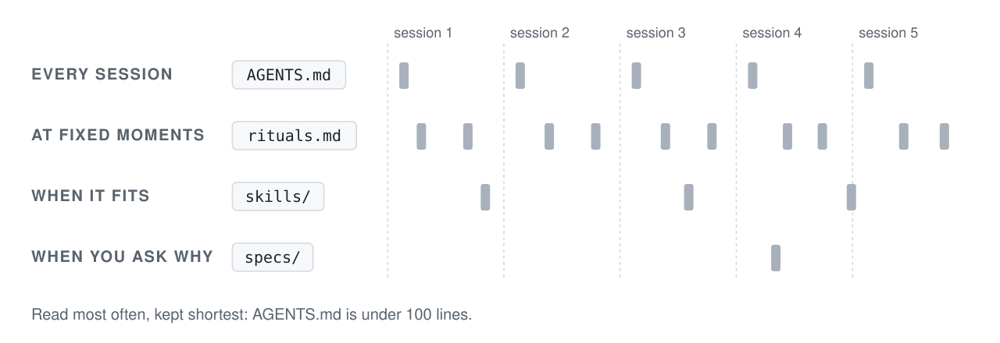

# system/

  <picture>
    <source media="(prefers-color-scheme: dark)" srcset="../.github/assets/system-dark.svg">
    
  </picture>

What the agent reads when a situation comes up. `AGENTS.md` at the root holds the seven rules that are always
loaded, and each of its last lines names one of these pages and the moment to open it.

- [`rituals.md`](rituals.md): what to do at a few fixed moments: entering a session, recording a decision, after
  writing files, before text goes to someone outside, when material comes in from outside, in a browser.
- [`code-writing.md`](code-writing.md): how code and comments are written here.
- [`person-ledger.md`](person-ledger.md): how to record what is already decided about a person, in layers.
- [`skills/`](skills/README.md): nine skills, each a folder the runtimes open by name.
- [`specs/`](specs/README.md): why the kit is built this way: decision records, requirements, and the page on whom
  each part is for.
- [`loop/`](loop/README.md): the improvement loop's guide, and the prompts it gives its workers.
- [`debate/`](debate/README.md): how two models from different vendors argue a decision before you make it.
- [`CHECKLIST.md`](CHECKLIST.md): the checks only a person can do: a company machine's IT policy, a backup
  of this folder, and one look at each runtime's hooks in a live session.
- `dev/`: for people changing the kit. The table of what checks each rule, the form of an evidence marker, and
  the record of what each runtime was seen to do.

`git pull` overwrites everything in this folder. What is yours goes in `instance/`.
