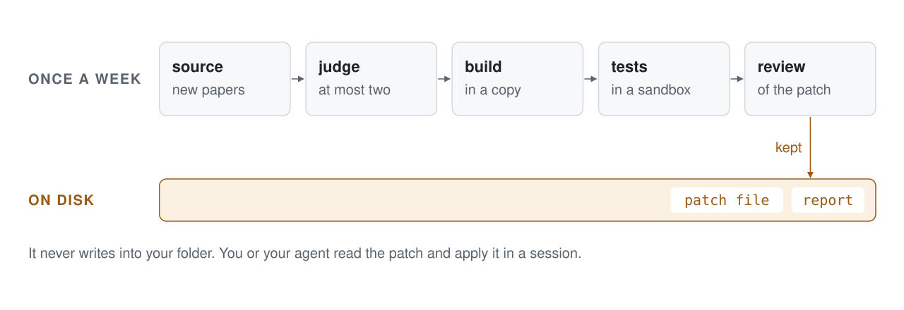

# The improvement loop

<p align="center">
  <picture>
    <source media="(prefers-color-scheme: dark)" srcset="../../.github/assets/loop-dark.svg">
    
  </picture>
</p>

The improvement loop is an optional weekly loop that proposes small changes to this kit's own files. It ships off,
runs on macOS only, and sends nothing until you say yes for a source. Each week a judge picks at most two proposals;
for each one a builder writes the change in a temporary clone, the tests run in a sandbox, and a reviewer that did
not build it reads the exact patch. A change that passes is saved as a patch file with a report; the loop never
writes into your files, never runs `git apply` in your folder and never commits. You or your agent read a saved
patch, apply it and run the tests in a session (section 4); passing tests and a review do not show that it helps you.

Each run of a source is a cycle. A worker is a headless call to your runtime (Claude Code or Codex; Gemini can be
named for a step in `loop.runtime_orders`) under your own account, so a cycle spends the same quota your sessions do.

## 1. Turning a source on, and what it sends

1. `python3 tools/options.py` lists the loop as off. Setup schedules nothing.
2. `python3 tools/options.py on loop` prints what leaves your machine and asks once. Without a terminal it changes
   nothing and prints the command to run after your yes, `python3 tools/options.py on loop sources=all yes`. With a
   source of your own added (section 8), it asks which sources may send, and your yes allows exactly those.
3. `python3 tools/options.py off loop` unschedules the loop's jobs, takes the permission back for every source and
   records your no, so setup does not offer the loop again. Cycle folders and saved patches stay.

What the kit's source sends:

- **papers** sends search queries and the client name (`loop.papers_client`) to arXiv, and a contact address only
  when `loop.papers_contact` is set. It downloads the full text of at most eight listed papers, then sends paper text
  and files of this kit to your runtime. Read papers are kept in `read.json` in `_private/papers/` and skipped later.
  It reads no message of your sessions. A source you added may offer its proposal worker evidence of its own; that
  source says so when you turn the loop on.
- Nothing goes to the kit's authors. Every cycle reads its permission and settings at its start, and papers reads
  them again right before it contacts arXiv. Workers write nothing themselves: the loop writes each step's file
  from the answer.

## 2. Running or scheduling a cycle

```bash
python3 tools/loop/loops.py run papers      # one cycle now; its last line names the report
python3 tools/loop/loops.py start papers    # schedule weekly, with the daily health check
python3 tools/loop/loops.py stop papers     # unschedule; stopping the last source unschedules the health check
python3 tools/loop/loops.py status          # what may send, each job's schedule, each source's last cycle
python3 tools/loop/lib/loop_config.py       # every setting of the loop block, the value in use and its meaning
```

Papers runs Wednesday 03:00 on this machine's clock unless `loop.schedule` says otherwise. A scheduled cycle
is skipped when it comes within seven days of its last cycle; `run` starts one at any time. A second run of a
cycle that is running skips. A cycle run again does not build a change it already finished.
`loop.token_ceiling` stops a cycle from starting a new model step once the tokens the model programs reported
reach it; steps already running may finish, and a run without a count does not move it. Any problem in the
`loop` block of `instance/config.json` (an unknown or repeated key, a wrong value, a path that is not one
literal relative path) stops every cycle with one line until you fix it.

The `/garden` command is not part of the loop: it is a report-only audit your session's own agent does when you ask.

## 3. Reading the report

Each cycle has one report, `REPORT.md` in its folder (`_private/work/papers/<date>-kit/` for papers),
drawn again from the cycle's records whenever a step ends. Its first line is the cycle's state:

- **pending**: collected and not judged yet, or a change is not finished; the report says what continues it.
- **done**: every change is saved, refused or abandoned.
- **failed**: a step broke; the report names it, and the next run tries again.
- **token-ceiling**: stopped at `loop.token_ceiling`; raise it, and the health check names the command that continues.

Then come the changes, in this order: **saved** (each with its block, below), **pending** (with why and what
continues it), then **refused** (with the stage and the reason: the never list or allowed area, the tests, the
commit check, the evidence or the review) and **abandoned** (both build attempts failed), one line each. A cycle with
nothing to do says so in one line. What the cycle collected follows, then run details and its model use.

A saved change's block says in one sentence what changes, lists its files, gives the evidence line (the check and
what the loop measured), who built and who reviewed it, the tests line with the number of tests the sandbox skipped,
the patch path, and the commands of section 4 with the real path.

When a cycle saves a change, it writes one private journal line naming the count and the report, so your next
session's state view (`python3 tools/now.py context`) shows it. Nothing is written when nothing was saved.

## 4. Applying a saved patch

For you or your agent, in a session, from the kit folder:

1. Read the change's block and the whole diff of the patch. Stop here if you do not want it.
2. `git apply --check <patch>`. If it does not apply (the files changed since the cycle), leave it; a later cycle
   may propose it again.
3. `git apply <patch>`.
4. `python3 tools/tests/run.py`. Here, outside the sandbox, the tests the sandbox skipped run too.
5. If a test fails, `git apply -R <patch>` takes the change back.
6. Tell the owner what changed and in which files. A commit is the owner's.

A patch changes the kit's own files, so until it is committed `git pull` stops with "Your local changes … would be
overwritten". Commit the applied patch: a later `git pull` then merges the kit's update with your change, and Git
names any file where both changed the same lines. `git apply -R <patch>`, before the pull, takes it back instead.

## 5. What the sandbox does

Each change is built in a temporary clone of your working tree as it was when the cycle started: your commit, your
tracked changes and the untracked files Git does not ignore. Folders named in `loop.clone_excluded` are left out of
the clone. Its tests run in macOS's sandbox, which denies by default: they may write only in the run's temporary
folder, read only that folder, the clone's Git objects, the toolchain and a few system files, and reach no network
(also not this machine's own addresses) and no terminal. They cannot read your home folder or `_private/`. A test that
cannot run in the sandbox is skipped by name, and the report counts it.

Before review a change is refused when it touches a path outside the allowed area or on the never list (`python3
tools/loop/loop_policy.py` prints both; `loop.never` adds paths), when a file it wrote is not in its patch or the
patch changes a file mode, when it brings a failure of the kit pre-commit check the starting commit does not have,
or when its evidence does not hold. The judge gives each change one check: `test` (a named test that must fail on
the starting commit and pass on the change), `cost` (the always-loaded context, `python3 tools/context_budget.py
--json`, must get smaller) or `unknown` (then the change may only record, not act). The loop measures the evidence in
its own runs. The reviewer comes from another runtime family than the builder's when one can be called; otherwise
from the same family, and the report says so.

## 6. Health check

The daily health check calls no runtime (run by hand without `--no-auth`,
`python3 tools/loop/loop_watchdog.py` makes one Claude Code call to check the login). It prints and writes
`WATCHDOG.md` in `_private/loops/` only while there is a problem: a settings problem, a source that has not
run for more than eight days, a failed cycle, a cycle at the token ceiling, a scheduled job
that is not loaded, or a health check that did not run in two days. It runs a failed cycle again at most once
a day with growing waits. You hear of a problem when it is first seen and when it is over.

## 7. Limits

- The loop assumes that the model which builds a change can be wrong, not that it is hostile. The sandbox keeps a
  change's tests away from your account and the network. A change that sets out to fool its own tests is not stopped
  by the loop; that is why the diff is read and the tests are run before a patch is applied.
- A test in the clone can read the clone and Git's objects, so `loop.clone_excluded` hides files of the clone, not
  their history.
- Each change names the one check that could show it does not help, but for most changes only your use shows it.
- A judge picks at most two changes per cycle, one that only records (`observe`) and one that acts (`act`), and at
  most one of them changes only the loop's own tools; each change gets at most two build attempts.
- Your runtime runs under your OS account and can read any file your account can read, as in your own sessions.
- A saved patch is checked against the tree of its cycle; if you edit the same files later, `git apply --check`
  tells you it no longer applies.
- The tests use stand-ins for the model programs. With real models, two `papers` cycles were run in fresh
  installations on 2026-11-25, on earlier versions of this loop: 11 and 8 model runs, 75 and 52 minutes, about 19
  and 16 million tokens as the programs reported them (most of it cached input read again), and one patch saved
  each time, with no tracked file of the installation changed. The weekly schedule has not been run with real
  models.
- macOS only: on another system every command but `status` ends with one sentence and a non-zero status.

## 8. Adding a source of your own

The kit ships one source, papers. A source of your own, such as one that reads your sessions, is one Python
module in `tools/loop/sources/` with its cycle program next to it;
[tools/loop/sources/README.md](../../tools/loop/sources/README.md) says what the module defines. The loop then
lists it beside papers: `on loop` says what it sends and asks for your yes, `loops.py` runs and schedules it,
the applier judges its cycles and the health check watches it. It is your code:
the kit's tests do not run it, and a kit update does not change it.
