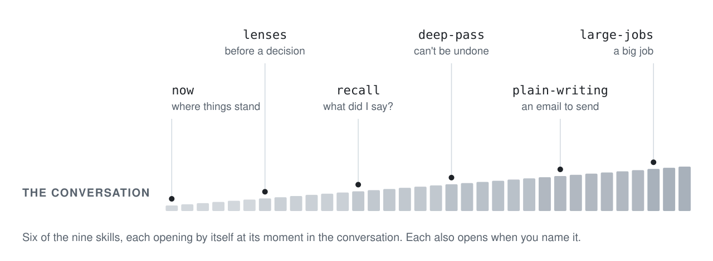

# system/skills/

  <picture>
    <source media="(prefers-color-scheme: dark)" srcset="../../.github/assets/skills-dark.svg">
    
  </picture>

Nine skills. A skill is a folder with a `SKILL.md`: two lines that say when to open it, and the body the agent
reads when it does. Claude Code, Codex and Antigravity read the same format, and in Claude Code a skill is also
the slash command of its name.

## Thinking and writing

| Skill | Opens when | What you get |
|---|---|---|
| [`lenses`](lenses/SKILL.md) | before committing to a design or a decision, when the same fix has failed twice, or when you ask | At most two of thirteen questions, each shown to you in one line with what it changed |
| [`deep-pass`](deep-pass/SKILL.md) | you ask for depth, or a decision cannot be undone, reaches people outside, is expensive or rests on one unknown | One recommendation, the strongest objection, and what would reverse it |
| [`plain-writing`](plain-writing/SKILL.md) | anything another person will read | Text that does one job for that reader |
| [`large-jobs`](large-jobs/SKILL.md) | before a job that reads everything, runs many workers or outlives the session | Six answers that fix how the job is judged and where it resumes |

`lenses` works without the rest of the kit: copy the folder and hand it to any agent, or read it yourself. The six
questions of `large-jobs` do too. Its longer page, `frame.md`, names the kit's own tools.

## Commands

| Skill | What it does |
|---|---|
| [`now`](now/SKILL.md) | Shows the current state, checks it, applies the repairs that are safe and can be undone, and proposes the rest |
| [`recall`](recall/SKILL.md) | Finds the original words of a past conversation |
| [`dossier`](dossier/SKILL.md) | Returns to a long thread through its file |
| [`garden`](garden/SKILL.md) | Audits state, journals, thread files and the runtime's memory folder against the record and writes a report. It corrects only what you delegated, in a form that can be undone |
| [`paper-to-kit`](paper-to-kit/SKILL.md) | Turns a list of papers into proposals for the kit, each with its evidence |

## One source, two copies

This folder is the source. `python3 tools/skills.py write` copies each skill byte for byte to `.claude/skills/`
and `.agents/skills/`, where the runtimes look, and `python3 tools/skills.py check` says where a copy differs. Edit
a skill here, then write.
