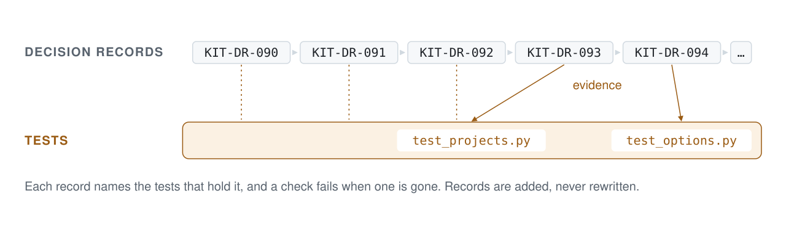

# system/specs/

  <picture>
    <source media="(prefers-color-scheme: dark)" srcset="../../.github/assets/specs-dark.svg">
    
  </picture>

Why the kit is built the way it is.

- [`kit-decisions.md`](kit-decisions.md): the kit's design decisions, one record each: what was decided, what led
  to it, what was measured, what was rejected, and when to look again. Records are appended, not rewritten. A
  later record that changes an earlier one says so in the earlier one's heading.
- [`model-assumptions.md`](model-assumptions.md): every part sorted by whom it is for: the person, a model's gap,
  a runtime's gap, or both. It also gives the reason for each limit on what the model is shown, what to do when a
  new model arrives, and what has been measured so far.
- [`PRD-session-memory.md`](PRD-session-memory.md): what state and memory must do across compactions and
  restarts.
- [`PRD-info-architecture.md`](PRD-info-architecture.md): where each kind of information lives: the source, what
  is written once, and what is drawn again from it.
- [`design-memory-runtime.md`](design-memory-runtime.md): how the three runtimes are wired to the same state.

Your own workspace's decisions do not go here. They go in `instance/decisions.md`, which `git pull` never
touches.
