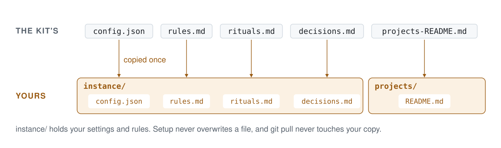

# templates/

  <picture>
    <source media="(prefers-color-scheme: dark)" srcset="../.github/assets/templates-dark.svg">
    
  </picture>

Blank forms. Setup copies each one into your workspace once, most of them into `instance/`, and never overwrites
a file that is already there. After that the copy is yours, and `git pull` does not touch it.

| Template | Becomes | What you write in it |
|---|---|---|
| `config.json` | `instance/config.json` | The workspace's name, your tracks and threads, the settings ([MANUAL.md section 2](../MANUAL.md)) |
| `rules.md` | `instance/rules.md` | The boundaries of this workspace: what is frozen, what may leave the machine |
| `rituals.md` | `instance/rituals.md` | Procedures that hold only here |
| `decisions.md` | `instance/decisions.md` | Your workspace's own decision records |
| `debate-round.md` | a prompt under `instance/debate/` | One round of a debate between two models, copied when you start one |
| `deep-pass-ledger.md` | `_private/deep-pass/ledger.md` | One row per deep pass, copied when you first record one |
| `projects-README.md` | `projects/README.md` | The guide to your project folders; the map below its markers is drawn for you |
