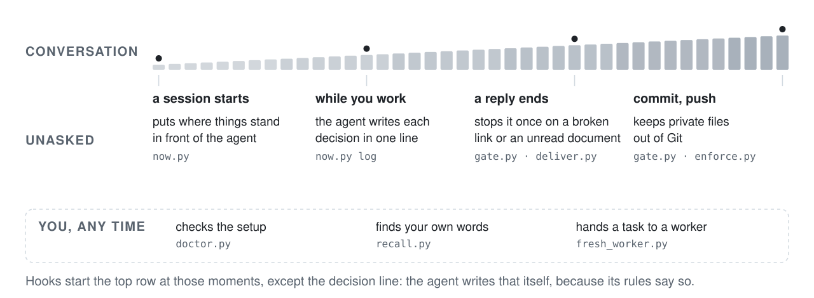

# tools/

  <picture>
    <source media="(prefers-color-scheme: dark)" srcset="../.github/assets/tools-dark.svg">
    
  </picture>

The commands you or your agent run. Each prints its usage with `--help` and reads and writes plain files. The
Python commands need nothing beyond the standard library, and the three shell scripts need Bash. Tools an
installation adds for itself are listed in a `README.local.md` beside this page, which `git pull` never touches.

## State: what is decided and what is open

- `now.py` writes one journal line (`log`), draws the state page from the journal (`render`), prints what a new
  session is given (`context`), lists the long threads (`threads`) and reports where state has drifted (`check`).
- `projects.py` lists the projects under `projects/` from the block at the top of each one's `README.md`
  (`list`), draws their map into `projects/README.md` (`draw`) and names what is missing (`check`).
- `triggers.py` keeps the things that should come up later and shows the due ones at session start.
- `notes.py` leaves a short note for the other sessions on this folder.
- `tasks.py` says in one line what this session and the others left running in the background.
- `facts.py` looks up the fact ledger: who said a fact, and the file it came from.
- `person_ledger.py` counts, and with `candidates` lists, the journal decisions and corrections not yet taken into
  the person ledger. It accepts none by itself.

## Search: what was said

- `recall.py` searches past sessions in the runtimes' own transcripts: `find` by words, by a time or by both,
  `index` to build the store of what you typed, `sessions` to list them.

## Checks

- `gate.py` blocks a turn end or a commit on an issue that its recorded baseline does not hold.
- `linkcheck.py` checks the file references in every Markdown file that Git does not ignore.
- `coherence.py` reports an index page that misses a newer file and a status page whose date has fallen behind.
  It changes no document.
- `enforce.py` checks what may leave through Git, and fails closed when it cannot measure.
- `adopt.py` takes a folder of existing material as it is: the links already broken in it stop no turn, and
  one inventory page stands in for reading the folder.
- `deliver.py` is optional: it looks once at a finished turn before the turn reaches you.
- `context_budget.py` measures the context a session here starts with.
- `doctor.py` checks the installation, the configuration, the hooks and the recorded checks, and names the next
  step.

## Workers: work outside the main conversation

- `fresh_worker.py` runs one bounded worker in Claude Code, Codex or Antigravity (Gemini) and prints its receipt.
- `ask.sh` gives one or two runtimes the same prompt, each as a fresh worker.
- `ask_codex.sh` is the short form for one Codex worker, without `ask.sh`'s other options.
- `receipts.py` lists the worker runs on record and shows their receipts.

## Setup and hooks

- `options.py` shows the optional parts and turns one on or off.
- `skills.py` copies each skill from `system/skills/` to the folders the runtimes read.
- `install_hooks.sh` checks and repairs the kit's two Git hooks.
- `hook.sh` is the one launcher every runtime hook calls.
- `dispatch.py` decides which steps run for a hook event, in which order and with how much time.
- `hook_canary.py` checks with real model calls, and only when asked, that a new Claude Code or Codex session
  receives its state with hooks on and does not with hooks off.
- `claude_auth.py` uses a credential you saved on purpose for Claude calls that have no terminal.

## Folders

- [`lib/`](lib/README.md): what the commands share. Nothing in it is run by hand.
- [`loop/`](loop/README.md): the improvement loop, off until you turn it on.
- [`tests/`](tests/README.md): the regression suite.
- `dev/`: for people changing the kit (.github/CONTRIBUTING.md says how). `dev/evidencecheck.py` checks the
  evidence markers of the decision records, `dev/skill_probe.py` measures whether the thinking skills open,
  `dev/eval_recall.py` measures whether a search finds a known message, and `dev/build_memory_map.py` draws the
  design map.
