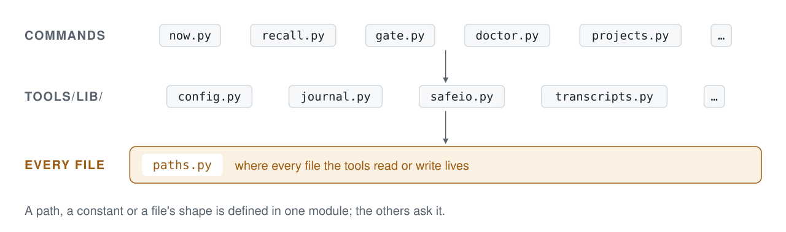

# tools/lib/

  <picture>
    <source media="(prefers-color-scheme: dark)" srcset="../../.github/assets/lib-dark.svg">
    
  </picture>

What the commands in `tools/` share. Nothing here is run by hand.

Two rules hold in this folder. No two modules of the kit import each other, here or in `tools/`. And one fact
has one home: a path, a constant or the shape of a file is defined in one module, and the others ask that
module.

| Module | The one thing it owns |
|---|---|
| `paths.py` | Where every file the tools read or write lives |
| `config.py` | Reading and validating `instance/config.json` |
| `config_migrate.py` | Writing that file at setup, and bringing an older one to the current form |
| `journal.py` | The journal row: its form, its validation, public or private, and appending one |
| `safeio.py` | Writing a file atomically, holding a lock file, naming a file by the hash of its bytes |
| `runlog.py` | The diagnostic logs: which checks ran, and which hooks failed |
| `hook_input.py` | What a hook run is given by its runtime |
| `hookdiag.py` | Reading the three runtimes' hook declarations |
| `turns.py` | The turn record, so that a finding blocks once per turn |
| `project_folders.py` | The owner's project folders: the block at the top of each one's README, and the map drawn from it |
| `adopted.py` | The links an adopted folder already had broken, which the turn-end check does not count |
| `transcripts.py` | The runtimes' session files, read as one stream of messages |
| `recall_store.py` | The messages you typed, as a small derived store, and the lists a search prints |
| `recall_literal.py` | The search by words |
| `recall_meaning.py` | The optional search by meaning, from an embeddings endpoint on this machine |
| `memory_index.py` | The audit of Claude Code's memory index |
| `worker_sandbox.py` | The folder a bounded worker runs in, and what it changed there |
| `precommit-hook.sh` | The one file both Git hooks are installed from |

Start with `paths.py`. Every other module finds its files through it.
