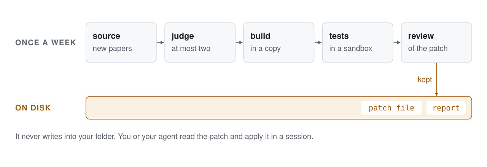

# tools/loop/

  <picture>
    <source media="(prefers-color-scheme: dark)" srcset="../../.github/assets/loop-dark.svg">
    
  </picture>

The improvement loop: once a week it gathers proposals to change the kit, builds each one in a copy, tests it,
has it reviewed, and ends at a saved patch. It is off until you turn it on, and it runs on macOS only. How to use
it, what it sends and what it cannot do are in [system/loop/README.md](../../system/loop/README.md). This page says
where the code is.

## Commands

- `loops.py` shows the loop's state, runs a source now, and schedules or unschedules a source.
- `loop_watchdog.py` is the daily health check: it checks the loop, repairs what it can, and says what needs you.
- `papers_apply.py` is the applier every source ends in: it judges, builds, tests and reviews, and saves each
  reviewed patch with its report. Nothing in it writes into the working tree.
- `loop_policy.py` says where the loop may change files: the never list and the allowed area, defined here only.
- `papers_cycle.sh` runs one cycle of the papers source, which reads new arXiv papers.
- `papers/sweep.py` finds candidate papers on arXiv by keyword.
- `papers/fetch_arxiv.py` fetches a paper's text.
- `sources/` holds the sources an installation adds; the kit ships none there ([its page](sources/README.md)).

## lib/

| Job | Modules |
|---|---|
| Running a cycle | `lib/loop_beat.py` (one beat: lock, log, workers, state file), `lib/loop_papers.py` (the stages of the papers source, in order), `lib/loop_sources.py` (every source the loop knows, papers and the ones added), `lib/loop_run.py`, `lib/loop_state.py`, `lib/loop_stores.py`, `lib/loop_common.py` |
| Settings and consent | `lib/loop_config.py` (the `loop` block of the configuration), `lib/loop_settings.py` (whether a cycle may start), `lib/loop_sending.py` (which source may send what to a model) |
| Workers | `lib/loop_worker.py`, `lib/loop_runtimes.py` (which runtimes a stage tries, in order), `lib/loop_prompts.py`, `lib/loop_contracts.py` (what a worker's document must contain) |
| Judging | `lib/loop_judge.py`, `lib/loop_judging.py` |
| Building and testing | `lib/loop_bundle.py` (one proposed change from record to outcome), `lib/loop_edits.py`, `lib/loop_isolate.py` (the clone and the sandbox), `lib/loop_checks.py`, `lib/loop_review.py` |
| Records and reports | `lib/loop_outcome.py`, `lib/loop_report.py` |
| Schedule and health | `lib/loop_jobs.py`, `lib/loop_watch_checks.py`, `lib/loop_watch_heal.py`, `lib/loop_watch_say.py` |
| This Mac | `lib/loop_platform.py` hands out the four modules that touch macOS: `lib/loop_macos_schedule.py`, `lib/loop_macos_alert.py`, `lib/loop_macos_process.py`, `lib/loop_macos_sandbox.py` |

To follow one cycle through the code, start at `lib/loop_beat.py` and then read `papers_apply.py`.
