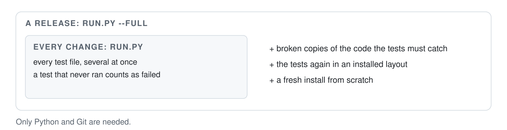

# tools/tests/

<p align="center">
  <picture>
    <source media="(prefers-color-scheme: dark)" srcset="../../.github/assets/tests-dark.svg">
    
  </picture>
</p>

The regression suite. It needs only Python and Git.

```bash
python3 tools/tests/run.py                              # every test file, a few side by side
python3 tools/tests/run.py --full                       # the slow cases too
python3 tools/tests/run.py --one tools/tests/test_gate.py
```

- `run.py` runs the test files and exits 1 if any failed. A test that is defined in a file and never ran fails
  that file.
- `testlib.py` holds what the suites share: skip marks, stand-ins for HTTP servers, and the gate fixture.
- `fixtures/runtimes/` holds hook inputs and transcripts captured from Codex and Antigravity, which the tests
  replay.

Two rules for a test. It never starts a real model program: each runtime is a stand-in the test writes itself. It
leaves nothing behind in the temporary folder. .github/CONTRIBUTING.md says when to run which.
